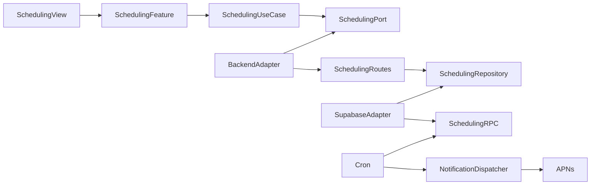
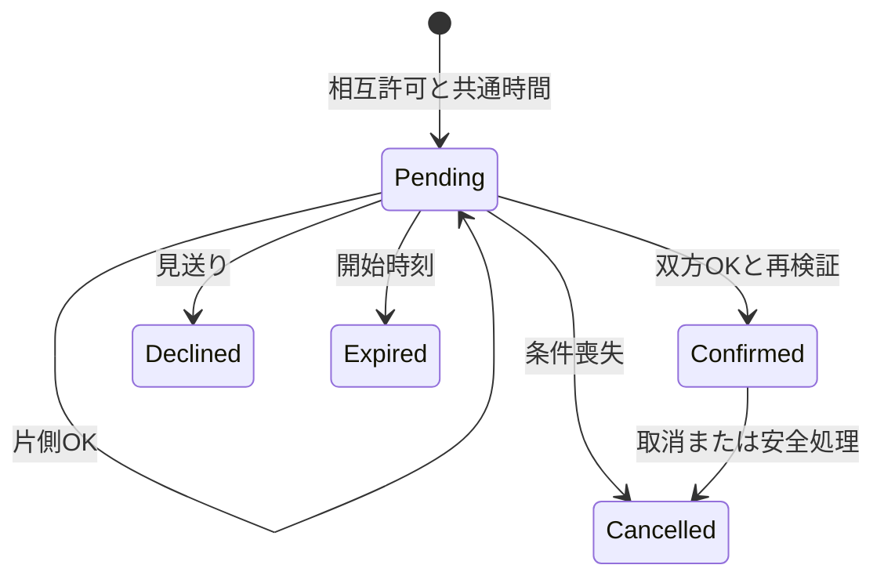

# Design Document

## Overview

AutomaticSchedulingを手動Hostingから分離し、2人の提案と確定予定を同じ集約で扱う。既存の認証・友達・本人暇を利用する。
新規依存は追加せず、Hono・Supabase Postgres/RPC・jose・SwiftUI/TCA・Swift Testingの既存スタックを使う。PushはAPNsへ署名付きリクエストを送り、外部資格情報が無ければ未配信を保持する。

## Boundary Commitments

### This Spec Owns

相互許可、共通時間選択、提案・回答・確定・取消、頻度、匿名投影、関連安全処理、アプリ内通知とPush配信キュー、iOS導線。

### Out of Boundary

既存友達追加・本人暇・認証を複製しない。手動Hostingの既存APIとデータを破壊せず、第一段階の主導線から外す。未知の人、LLM、自由投稿、カレンダー、店舗、再調整は追加しない。

### Allowed Dependencies

Presentation→Application→Domain、Infrastructure→Application/Domain、Composition→各層。既存AppFeature/AppRuntimeへの接続は現行構造を保ち、新機能内部へ業務状態を分離する。
Postgres関数は既存のaccount active・friendships・availabilityの正本を照合専用に参照し、利用者の本人限定RLSを広げない。

### Revalidation Triggers

暇区間、友達解除、削除状態、公開投影、許可、版管理、通知配送契約の変更時に下流iOSとDB試験を再検証する。

## Architecture

本人JWTの同期APIとservice-roleの定期実行を分離する。定期実行は15分ごと、許可・暇の変更でも再評価する。
全関連書込はscheduling lock→既存owner/pair lock→rowの順を守り、同時回答、暇変更、友達解除、削除と直列化する。小規模検証のため単一のtransaction advisory lockを採用する。既存RPCは追加migration内のwrapperで先にlockを取る。直接DMLもstatement triggerで保護する。

## File Structure Plan

| パス | 責務 |
| --- | --- |
| apps/backend/src/AutomaticScheduling/Domain/Model | 公開投影・入力・エラー |
| apps/backend/src/AutomaticScheduling/Application/Port | 永続化ポート |
| apps/backend/src/AutomaticScheduling/Infrastructure/Repository | 本人JWT RPC変換・公開DTO検証 |
| apps/backend/src/AutomaticScheduling/Presentation/Route | HTTP入力・認証・エラー |
| apps/backend/src/AutomaticScheduling/Infrastructure/Adapter | service-role tick |
| apps/backend/src/Notification/Application/Port, Application/UseCase | 配送とPushのポート、lease済み配送の結果処理 |
| apps/backend/src/Notification/Infrastructure/Adapter, Infrastructure/Repository | APNs署名送信・outbox RPC |
| apps/backend/src/Notification/Composition/Factory | 環境設定の検証と配送依存の組立 |
| apps/backend/src/Composition/createApp.ts | 新APIの依存注入 |
| apps/backend/src/EntryPoint/index.ts, apps/backend/wrangler.jsonc | scheduledと通知dispatch、環境別cron |
| supabase/migrations/202610300001_automatic_scheduling.sql | 新規テーブル・RPC・wrapper・trigger、既存データ維持 |
| supabase/tests/automatic_scheduling.test.sql | 実DBの認可・頻度・確定・安全・並行条件 |
| apps/ios/Himatch/AutomaticScheduling | Domain/Model、Application/Port・UseCase、Infrastructure/Adapter、Presentation/Reducer・View |
| apps/ios/Himatch/App/Composition | 実認証依存とAPNs接続 |
| apps/ios/Himatch/App/Presentation | Home・Inbox・友達・設定への委譲、session世代管理 |
| apps/ios/HimatchTests | 新DTO/Reducer/統合と既存Home/Siri回帰 |

## Components and Interfaces

### 同期API

すべてSupabase Bearer tokenから本人を確定し、no-storeとする。レスポンスは共通snapshotをenvelopeなしで返す。

| Method | Endpoint（/v1/automatic-scheduling配下） | Request |
| --- | --- | --- |
| GET | / | なし |
| PUT | /settings | enabled, operationId |
| PUT | /permissions/{friendId} | enabled, operationId |
| PUT | /proposals/{id}/response | response accepted/declined, shareAcceptance, operationId, expectedVersion |
| POST | /proposals/{id}/cancel | operationId, expectedVersion |
| PUT | /proposals/{id}/feedback | played, bothersome, privacyConcern, operationId |
| POST | /blocks/{friendId} | operationId |
| POST | /proposals/{id}/block | operationId |
| POST | /proposals/{id}/report | reason spam/harassment/other, operationId |
| POST | /reports/{friendId} | reason spam/harassment/other, operationId |
| PUT | /device | token hex64, environment sandbox/production, enabled |

snapshot: `{ enabled, permissions: [{friendId, enabled}], proposals: [{id,start,end,status,myResponse,version,shareAcceptance,peer?,peerResponse?,feedback?}], notifications: [{id,proposalId,kind,createdAt}] }`。
statusはpending/confirmed/declined/expired/cancelled、myResponseはpending/accepted/declined、peerは最小プロフィールuserId/nickname/presetIconKey。
peer/peerResponseを返せるのはconfirmed、または相手がacceptedかつshareAcceptanceを明示した場合だけ。それ以外はフィールド自体を返さない。本人の回答・許可の表示は他者の許可を露出しない。
versionは本人の回答行単位。片方のOKで相手のversionを変えず、双方がversion1で同時回答しても成立可能にする。取消は集約状態と本人versionを再検証する。
全mutationはactor+operationId+内容を記録し、同一内容再送は二重適用せず最新の安全なsnapshotを返す。異なる内容・種類への同ID再利用は409。deviceは自然キーupsertで冪等。
401認証、400入力、404利用不可、409競合、503依存失敗を既存error envelopeに合わせる。本文・token・暇・peerの情報をログへ転記しない。

### DB・自動実行

privateなsettings、friend permissions、proposals、responses、operations、blocks、reports、feedback、notifications、device/deliveryを保持する。raw table権限をanon/authenticatedへ与えず、security definerは固定search_path・auth.uid・account active・参加者を確認する。
public RPC名は `automatic_scheduling_snapshot/settings/permission/respond/cancel/feedback/block/report/device`、パラメータはp_のsnake_case。
匿名提案からのブロックは `automatic_scheduling_block_proposal(p_proposal_id,p_operation_id)` で相手をサーバー内で解決し、相手IDをクライアントへ開示せず実行する。
プロフィール通報は `automatic_scheduling_report_friend(p_friend_id,p_reason,p_operation_id)` で既存の関係・提案当事者を検証し、提案IDがない場合も定型理由を受け付ける。
サービス専用 `automatic_scheduling_tick()` が期限・無効条件を再評価し、最早の共通半開区間を最大24時間で切る。直近7日間どちらかに提案があれば生成せず、同ペアは14日間あける。作成履歴は終了・見送り・取消でも件数へ残す。
一人の未確定提案は1件まで。確定時と生成時に他の確定予定との重複を防ぐ。両者のOKが揃ったtransactionでstatusをconfirmedへ更新し、両者の確定通知を一意に作る。
暇変更・許可オフ・友達解除ではpendingを終了する。確定後は暇変更・許可オフ・友達解除だけで予定を消さず、別取消とする。ブロックと退会は未来confirmedも取り消す。解除・再追加で許可を復活させない。
ブロックは既存の申請と手動招待もサーバーで拒否する。通報は当事者のみ、任意のブロックと分離する。

### 通知

アプリ内通知は提案・確定・取消のtransactionで保存し、APNs配送はoutboxで分離する。device登録以後の通知だけを端末へ配送する。
`automatic_scheduling_delivery_claim()` はサービス専用で最大50件を5分leaseし、`{id,token,environment,kind}`を返す。`automatic_scheduling_delivery_finish(p_id,p_outcome)`でsent/retry/invalid_tokenを処理する。配送IDは通知×端末で一意、APNs collapse IDに用いる。
APNS_TEAM_ID/KEY_ID/PRIVATE_KEY/TOPICを使いES256でtokenを署名する。本文は汎用の更新案内のみ。無効tokenを停止し、一時失敗は再送する。資格情報なしで配信成功にはしない。
iOSは明示操作でOS許可を求め、token/environmentを本人へ登録する。ログアウト時に無効化し、本人変更で他者へ届かないようDB側でもtoken所有者を一意にする。Pushから開いた場合はアプリで認証・最新状態を取得する。

### iOS状態

新機能Reducerがsnapshot、送信操作ID、optional shareAcceptance（初期false）、失敗、領域revisionを所有する。AppFeatureはnavigationとCompositionへ接続する。UseCase→Port→Adapterを通す。
起動・foreground・受信箱と関連変更後に再取得し、旧session/旧revision応答を破棄する。送信中に重複操作を止め、結果不明なら同操作IDとpayloadで再試行する。競合が確定したら再取得し新状態へ戻る。
Home/Inboxに匿名提案と実confirmed予定、友達に本人の友達別許可、設定に全体許可・通知許可を表示する。OK共有は任意スイッチで、日時の再選択と別確認は不要。
実施後feedbackは任意で、遊べた/煩わしい/プライバシー懸念を保存する。未回答を遊べたとしない。計測はこれらの事実と母数で行い、個人の暇を一般ログへ出さない。

## System Flows

## Requirements Traceability

| Requirement | Components | 検証 |
| --- | --- | --- |
| 1.1–1.6 | settings/permissions/blocks/account hooks, iOS settings | 初期off・片側許可・再追加・解除と予定の分離 |
| 2.1–2.5 | tick/availability wrappers/Cron | 最早区間・15分/24h・競合・非起動検出 |
| 3.1–3.5 | DB projection/DTO/iOS card | 匿名・共有選択・推測限界の説明・no raw slot |
| 4.1–4.6 | respond/operations/transaction | 同時OK・片側OK・期限・競合・冪等 |
| 5.1–5.6 | cancel/block/report/deletion hooks | 関連停止・他者認可・予定取消 |
| 6.1–6.5 | notifications/outbox/APNs/iOS composition | 永続化・配信失敗・拒否・最新取得 |
| 7.1–7.3 | proposal history/global lock | rolling7日・pair14日・取消後の上限 |
| 8.1–8.6 | feedback/proposal history/test evidence | 実施と確定の区別・母数/未回答・安全 |

## Error and Testing Strategy

Worker route/adapter testsは認証・入力・投影のfail closed・RPC変換・scheduler失敗を検証する。DB試験は2人以上の実データで認可・頻度・両OK確定・同時操作・許可/暇/安全変更・配送leaseを検証する。
iOSはSwift TestingとTCA TestStoreで片側OK・shareAcceptance・通信失敗・同操作再試行・session切替・Home/Inbox接続を検証する。XcodeBuildMCPを優先する。
STG deploy、実APNs、複数実機、TestFlight upload、5〜20人の遊びの検証は外部実行として証拠を別に記録し、ローカル試験と混同しない。

## Migration Strategy

追加migrationのみとし旧データを削除しない。全体と友達別の許可は既存ユーザーもoff。API互換性を維持し、手動Hostingは既存機能として扱う。新機能の配布前にSTG migrationと2アカウントE2Eを実施し、失敗時は自動提案を停止する。
