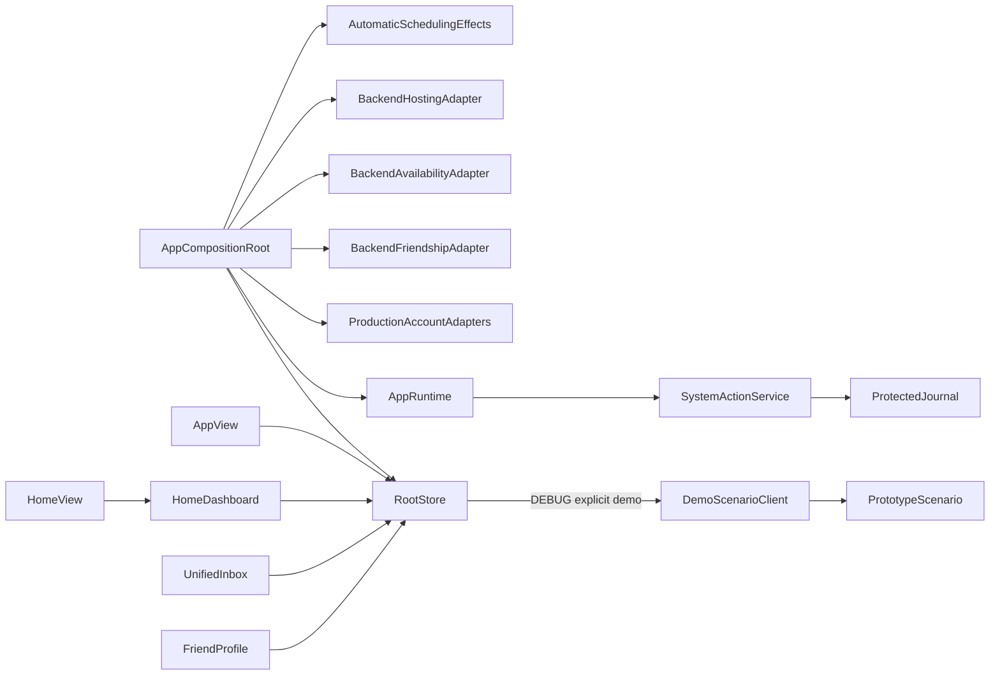

## 第一段階での適用（2026-10-30）

AutomaticSchedulingの実Clientを共通認証へ注入し、起動/foreground/受信箱で再取得する。旧session・旧revisionの応答を捨てる。Home/Inbox/友達/設定へ提案・確定予定・許可を投影し、新機能の業務状態を所有元Reducerへ集約する。

新しい受け入れ条件と実装タスクは [自動提案・予定成立](../automatic-friend-scheduling/requirements.md) と [その実装計画](../automatic-friend-scheduling/tasks.md) を正本とする。既存タスクのチェックは記載された既存契約の証拠であり、新しい提案・確定・通知・安全の達成を示さない。


# Design Document

## Overview

`AppRuntime` が実Adapterと操作Clientを一度組み立て、`AppCompositionRoot` がそれらをTCA Storeへ注入する。Siriも同じ runtime を利用する。認証・プロフィール・削除・Friendship・本人の暇時間・Hosting は実Backend Adapterを標準とし、最初の内部TestFlightではSTGへ接続する。`HimatchPrototypeScenario` actorはDEBUGの明示的なデモと未接続機能だけに限定する。

起動時は削除受付状態とセッションを先に判定し、プロフィールの有無でメイン画面か初期設定画面を決める。プロフィール確定後はメイン画面を表示し、友達と本人の暇時間を独立した Effect で並行取得する。各取得状態は専用フラグで Home / Friends の領域に表示し、共通 `isLoading` の全面オーバーレイは読み取りに使わない。失敗時は各領域から再試行でき、片方の失敗で他方の表示を消さない。

## Boundary Commitments

### This Spec Owns

- Root Composition、横断 read model、共有 Prototype scenario、fixture reset、全機能統合テスト。

### Out of Boundary

- 個別機能の業務規則、暇と募集の実Backendトランザクション・API自体、Push。通常Debug/Release Adapter の注入は本仕様が所有する。明示デモだけPrototypeを利用する。

### Allowed Dependencies

- 新規5仕様の Domain / Application / Presentation 契約。Composition だけが Infrastructure 実装を参照できる。

### Revalidation Triggers

- 機能 Port、projection DTO、Root Navigation、fixture schema、TCA/Xcode の変更。

## Architecture



## File Structure Plan

```text
apps/ios/Himatch/App/Composition/AppCompositionRoot.swift
apps/ios/Himatch/App/Composition/AppRuntime.swift
apps/ios/Himatch/App/Presentation/SystemActionHandoff.swift
apps/ios/Himatch/App/Presentation/SystemActionReviewView.swift
apps/ios/Himatch/App/Infrastructure/Prototype/HimatchPrototypeScenario.swift
apps/ios/Himatch/App/Infrastructure/Prototype/DemoScenarioClient.swift
apps/ios/Himatch/App/Presentation/AppFeature.swift
apps/ios/Himatch/App/Presentation/AppView.swift
apps/ios/Himatch/App/Presentation/Home/HomeDashboard.swift
apps/ios/HimatchTests/AppIntegration/
```

## Contracts

`AppFeature` は各所有機能の取得結果を Root State に合成し、`HomeDashboard` はその状態から区分順・主操作・お知らせ件数だけを同期的に投影する。Home / Inbox / FriendProfile の変更操作は Store の Action を所有機能へ route し、横断投影専用 Repository や変更 API を設けない。旧Hostingの確定予定と `friendPlans` fixtureはDEBUG専用とする。新しいAutomaticSchedulingのsnapshotは実Backendの提案・確定予定を持ち、Home / Inbox は `AutomaticSchedulingFeature` の State と Action を参照する。

`HimatchPrototypeScenario` は actor 内で全 fixture を保持し、feature adapter factory と reset(seed) を提供する。block/delete は actor メソッド一回で関連状態と revision を更新する。各 Adapter は自機能 Port だけを実装する facade である。

DEBUG の明示デモでは Root が `@Dependency(\.demoScenarioClient)` の `business` を `isDemo` のときだけ選択し、デモのプロフィール保存と手動のお誘いを Prototype で処理する。自動提案は Composition が `AutomaticSchedulingEffects.routingDemo` を注入し、所有者 `"demo"` だけを `DemoScenarioClient.scheduling` へ振り分ける。通常 Debug/Release、実アカウントの AutomaticScheduling、Siri の実Backend Client は維持する。`DemoScenarioClient`、`HimatchPrototypeScenario`、routing の注入は `#if DEBUG` で Release から除外する。

## Siri 操作との統合契約

システムからの入力・補完・再送は ios-siri-actions が所有し、Rootは入力を保持した認証後の復帰と表示を所有する。AppViewの初回起動、scene active、認証後のmain遷移、システム操作通知で、注入済みHandoff Clientを通じて未完了記録を検査する。JournalのcreatedAt順で一件ずつ表示し、完了後に次を取得する。再通知で表示中の入力を上書きしない。

本人識別はプロフィール通信の成功と分離し、復元済みsessionのuserIDへ引継ぎを束縛する。プロフィールGETが失敗しても本人不明の記録へ変換しない。本人変更・サインアウト・退会受付では旧本人のownerUserIDまたはentityOwnerUserIDに一致する準備済み操作とnil-ownerの未送信操作を失効させ、未送信記録を破棄する。送信済み不明結果は旧本人別に隔離して別アカウントに再送しない。成功後の暇・募集一覧はRootの独立した再取得を使う。Siri用の本人束縛Clientは募集作成・取消のmutation後GETを省略し、通常Root Clientは従来のsnapshot取得を維持する。

この実装と検証のタスクは [Siri実装計画](../ios-siri-actions/tasks.md) 2–7に集約し、本仕様へ重複した完了チェックを増やさない。実機SiriとSTG実アカウント検証の未実施を構造検査や単体テスト成功で代替しない。

## Requirements Traceability

| Requirement | Components | Validation |
|---|---|---|
| 1.1-1.4 | HomeDashboard, AppFeature, Root route | projection / navigation tests |
| 2.1-2.5 | HimatchPrototypeScenario, facets | actor / reset / cross-effect tests |
| 3.1-3.5 | AppCompositionRoot, integration tests | build / Swift Testing / Simulator smoke |
| 3.6-3.12 | ProductionAccountAdapters, BackendFriendshipAdapter, BackendAvailabilityAdapter, BackendHostingAdapter, AppFeature | composition / staging config / restore / invite response tests |

## Testing Strategy

- iOS テストは Swift Testing に統一し、repository verify で XCTest の再混入を拒否する。
- actor: reset、block/delete 原子的更新、revision。
- projection: owner ID、privacy-safe DTO、順序と区分。
- Root: delegate action が所有機能へ遷移する。
- Simulator: デモの主要経路。Backend安全性は MANUAL/BACKEND_REQUIRED として別判定する。

## はじめての予定動線による変更
ホームの投影は `HomeDashboard`（区分順・主操作・お知らせ件数）に置き換え、AutomaticScheduling の提案と確定予定を「遊ぶ時間の提案」「決まった予定」区分として最上位側に並べた。時間軸はホームから開くカレンダー画面へ移し、確定提案も同じ投影で表示する。DEBUG デモは `DemoScenarioClient` 経由で Prototype シナリオを使い、`HimatchPrototypeScenario` と共に `#if DEBUG` で Release から除外した（この設計の 3.6 の意図どおりに修正）。デモの自動提案は所有者 `demo` だけを `AutomaticSchedulingEffects.routingDemo` で Prototype へ振り分け、実アカウントの Adapter は変えない。アカウント境界ではお誘いの画面状態も破棄し、作成・返事・取消の結果を開始時の所有者で照合する。詳細は [ios-first-match-flow の設計](../ios-first-match-flow/design.md)。
