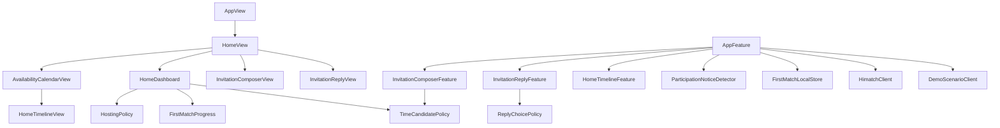
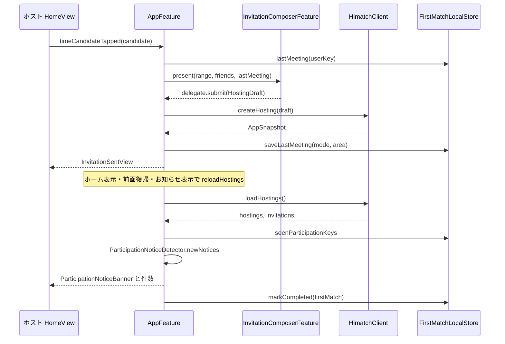
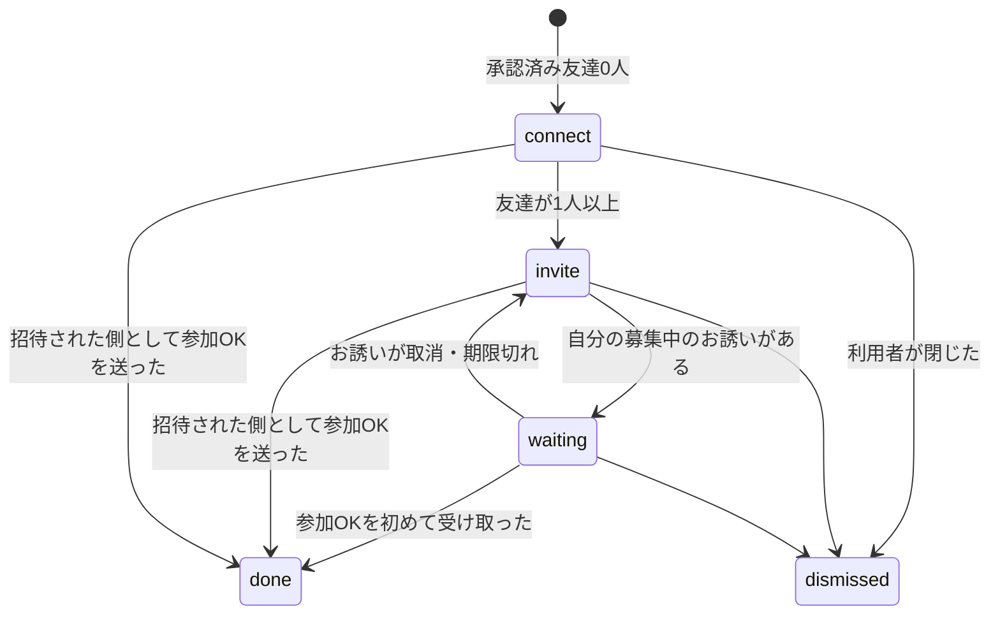

# Design Document

## Overview
**Purpose**: 初回利用者が起動から最初の参加OKまでを画面の案内だけで進められるよう、ホームの構成、お誘いの開始経路、作成入力、返事の操作、参加OKの受け取り表示を作り直す。
**Users**: ホストとして友達を誘う利用者、招待されて返事をする利用者、DEBUG デモで動線を確認する開発者・評価者。
**Impact**: ホームの主表示を時間軸からホーム投影（次にやること）へ移す。`AppFeature` に直接置かれているお誘い作成の状態を子 Reducer へ切り出し、返事の±操作を選択肢へ置き換える。Backend API、`HimatchClient` の業務契約、保存形式は変えない。DEBUG デモを Prototype シナリオへ接続し直す。

### Goals
- 要件 1〜11 を、既存の Hosting・Availability・Friendship の UseCase と Backend 契約のまま満たす。
- 純粋な判定（時間候補、返事の選択肢、全員そろう時間、案内の段階、ホーム区分）を Domain / 投影関数に置き、Swift Testing で単体検証できるようにする。
- `AppFeature` の肥大化を止め、お誘い作成と返事を独立した子機能として並行実装できる境界にする。

### Non-Goals
- 友達の暇の公開・照合、予定確定、Push、Backend の新 API、サーバー側の既読管理。
- 時間軸（`HomeTimelineView` と配下）の操作仕様の変更。配置だけを変える。
- Siri・ショートカットの Intent 名と語句。
- Android。

## Boundary Commitments

### This Spec Owns
- ホーム投影 `HomeDashboard`：区分の有無と順序、お知らせ件数（2.1、2.6）。
- はじめてのお誘いの段階判定と端末内の完了記録（3.x）。
- 時間候補の生成規則 `TimeCandidatePolicy`（4.1〜4.3）。
- お誘い作成の画面状態 `InvitationComposerFeature`：入力、検証メッセージ、会い方の前回値、暇の属性競合の確認（5.x、4.4〜4.6）。
- 返事の画面状態 `InvitationReplyFeature` と選択肢の規則 `ReplyChoicePolicy`（7.2〜7.7、7.10）。
- 参加OKの新着検出 `ParticipationNoticeDetector` と既読記録（8.1）。
- 全員そろう時間の算出 `HostingPolicy.everyoneAvailable`（8.3）。
- アプリ内のお誘い関連の文言（9.1）。
- DEBUG デモの開始状態の選択、デモ友達の参加OK、Prototype シナリオの Release 除外（10.x）。

### Out of Boundary
- 募集の作成・回答・取消の API 呼び出し、operationID と expectedVersion、競合時の再取得は既存の `AppFeature` のハンドラと `HimatchClient` のまま（ios-hosting 7.x）。子機能は `HostingDraft` と回答内容を delegate で返すだけにする。
- 暇の OR 統合・検証・区間削除は Availability の既存 Policy と Adapter。
- 招待コードの表示・共有・入力・申請は Friendship の既存画面（`AddFriendView`）を再利用する。
- 非公開表示の契約（配信人数・未回答者・見送りを出さない）は ios-hosting 2.x の既存契約に従い、この仕様で新しい情報を取得しない。

### Allowed Dependencies
- Presentation → Application / Domain（既存方針）。新しい子 Reducer は `AppFeature` から Scope で合成し、delegate Action で結果を返す。
- `FirstMatchLocalStore` は Application の Port とし、UserDefaults 実装を Infrastructure、注入を Composition に置く。
- Domain の新規型は Foundation だけに依存する。

### Revalidation Triggers
- `Hosting`・`Participation`・`HostingInvitation` の形や `isHostedByMe` の意味が変わったとき（ホーム区分と参加OK検出が依存）。
- `HostingDraft` の項目や `availabilityMetadata` の扱いが変わったとき（作成子機能が依存）。
- `AvailabilityPolicy` の14日・15分境界の規則が変わったとき（時間候補と日時選択が依存）。
- ios-hosting 2.x の非公開表示契約が変わったとき。

## Architecture

### Existing Architecture Analysis
- `AppFeature`（約1500行）が認証、友達、暇、お誘い作成の全入力、返事、取消、受信箱を持つ。お誘い作成の入力は `hostingMode` など11個のフィールドとして Root State に直接ある。
- ホームは `HomeView` が `HomeTimelineView` を主表示とし、お知らせはシート `InboxView`、自分のお誘いは `HostingListView` シートにある。
- 返事は `InvitationResponseSelection`（Domain）が±操作と「確認済み」状態を持つ。
- デモは `isDemo` フラグで Backend 読み込みを止めるが、`himatchClient` は常に本番の `runtime.business` が注入され、デモの保存が `productionPlaceholder` の固定エラーになる。`HimatchPrototypeScenario` は Release にもコンパイルされる。
- お誘いの一覧は `reloadHostings`（認証後とお知らせを開いたとき）でだけ更新される。

### Architecture Pattern & Boundary Map



- 採用パターン：既存の TCA 親子合成と Domain の純粋関数。ホームは状態を持たない投影関数 `HomeDashboard.make` で描画データを作る。
- 新しい子 Reducer は2つ（作成、返事）に限る。ホームの区分ごとに Reducer を作らない。区分は読み取り投影で、操作は Root の既存 Action へ送る。
- Steering 準拠：入力の再要求をしない（候補・友達・範囲の引き継ぎ）、安全な初期値（非公開・未選択）、意思が変わる項目だけ確認（会い方、属性競合）。

### Technology Stack

| Layer | Choice / Version | Role in Feature | Notes |
|-------|------------------|-----------------|-------|
| UI | SwiftUI（iOS 17+） | ホーム、作成、返事、カレンダー画面 | 既存 `HimatchTheme` のトークンと部品を使う |
| 状態 | TCA 1.26.1 | 子 Reducer の合成、TestStore 検証 | 既存バージョンを維持し依存を追加しない |
| 端末内記録 | UserDefaults | 案内の完了、会い方の前回値、参加OKの既読キー | アカウント別キー。時刻や名前は保存しない |
| テスト | Swift Testing | Policy、投影、Reducer、デモ経路 | XCTest を使わない |

## File Structure Plan

### Directory Structure
```
apps/ios/Himatch/
├── App/
│   ├── Domain/
│   │   └── FirstMatchProgress.swift            # 案内の段階判定（純粋関数）
│   ├── Application/Port/
│   │   └── FirstMatchLocalStore.swift          # 案内記録・会い方の前回値・既読キーの Port と値型
│   ├── Infrastructure/
│   │   ├── Store/UserDefaultsFirstMatchStore.swift   # Port の UserDefaults 実装
│   │   └── Prototype/
│   │       ├── HimatchPrototypeScenario.swift  # #if DEBUG で囲み、seed を2種に拡張
│   │       └── DemoScenarioClient.swift        # DEBUG のデモ専用 client（業務 client、reset、デモ友達の参加OK）
│   └── Presentation/Home/
│       ├── HomeDashboard.swift                 # ホーム区分の投影とお知らせ件数
│       ├── HomeSectionViews.swift              # 案内カード、届いたお誘い、自分のお誘い、時間候補、暇の一覧
│       ├── CandidateTimeBar.swift              # 候補の帯と参加時間の重ね表示（VoiceOver 文言を含む）
│       ├── ParticipationNoticeBanner.swift     # 参加OKの一時表示
│       └── AvailabilityCalendarView.swift      # 既存の時間軸と選択バーを載せる二次画面
└── Hosting/
    ├── Domain/
    │   ├── TimeCandidatePolicy.swift           # 時間候補の生成
    │   ├── ReplyChoicePolicy.swift             # 全体・前半・後半と指定範囲の検証
    │   ├── ParticipationNoticeDetector.swift   # 参加OKの新着判定と既読キー
    │   └── HostingModels.swift                 # HostingMode.displayName、HostingPolicy.everyoneAvailable を追加
    └── Presentation/
        ├── Reducer/
        │   ├── InvitationComposerFeature.swift # お誘い作成の状態と delegate
        │   └── InvitationReplyFeature.swift    # 返事の状態と delegate
        └── View/
            ├── InvitationComposerView.swift    # いつ・だれと・会い方・なにする・下部固定の送信
            ├── InvitationSentView.swift        # 送信結果
            └── InvitationReplyView.swift       # 選択肢、帯、説明、送信・見送り・取消
```

### Modified Files
- `App/Presentation/AppFeature.swift` — お誘い作成の11フィールドと関連 Action を `InvitationComposerFeature` の Scope に置換。返事は `InvitationReplyFeature` を `@Presents` で合成。`business(for:)` でデモと本番の client を切り替え、全呼び出し箇所を置換。参加OK検出、案内記録、時間候補・暇・友達からの開始 Action、ホーム表示時とフォアグラウンド復帰時の `reloadHostings` を追加。文言を「お誘い」系へ変更。
- `App/Presentation/Screens/HomeView.swift` — `HomeDashboard` の区分を描画する構成に置換。時間軸は `AvailabilityCalendarView` へ移す。主操作を友達の有無で切り替える。`HostingListView` を削除し、自分のお誘いはホームで表示。
- `App/Presentation/AppView.swift` — 登録前画面を3段階の説明へ変更。デモ開始を2種類の開始状態に分ける。友達一覧の各行と友達詳細に「誘う」を置く。`HostingEditorView` と `InvitationResponseCard` を削除し、受信箱から新しい返事画面を開く。お知らせの件数バッジ。文言変更。
- `App/Presentation/AppDependencies.swift` — `firstMatchLocalStore` と（DEBUG）`demoScenarioClient` の DependencyKey を追加。
- `App/Composition/AppCompositionRoot.swift` — 新しい依存を注入。Release ではデモ client を注入しない。
- `Hosting/Domain/HostingModels.swift` — `InvitationResponseSelection` を `ReplyChoicePolicy` に置き換えて削除。`HostingMode` に表示名（オンライン／会う）を追加し、rawValue と Codable は変えない。
- `Availability/Domain/AvailabilityModels.swift`、`Availability/Presentation/Component/AvailabilityFormatting.swift`、`Availability/Presentation/View/HomeTimelineView.swift`、`Availability/Presentation/View/TimelineGridViews.swift`、`App/Presentation/SystemActionReviewView.swift` — アプリ内表示の「募集」「回答」を「お誘い」「返事」へ変更。Intent 名と `AppShortcuts.xcstrings` は変更しない。
- `HimatchTests/` — 下記「Testing Strategy」のテストを追加・更新。

## System Flows

### 初回のお誘いから参加OKの受け取りまで



- 参加OKの検出は Push を使わず、既存の取得経路の結果を差分判定する。取得のきっかけに、ホームが表示されたとき（`task`）とアプリが前面に戻ったときを加える。
- 既読キーの保存はバナーを表示したとき、またはお知らせを開いたときに行う。

### はじめてのお誘いの段階



- `done` と `dismissed` は端末内に記録し、以降は計算せずに非表示にする（3.4、3.5）。
- `connect` で招待コード共有済みかは端末内の記録で判定する（3.3）。共有シートを開いた時点で記録する。

## Requirements Traceability

| Requirement | Summary | Components | Interfaces | Flows |
|-------------|---------|------------|------------|-------|
| 1.1–1.3 | 登録前の3段階と非公開の説明 | OnboardingView（AppView） | — | — |
| 2.1, 2.6 | 区分の順序とお知らせ件数 | HomeDashboard | `HomeDashboard.make` | — |
| 2.2 | 時間軸を二次画面へ | AvailabilityCalendarView、HomeView | 既存 HomeTimelineFeature | — |
| 2.3, 2.4 | 主操作の切替 | HomeView | `AppFeature.Action.primaryActionTapped` | — |
| 2.5 | 暇の一覧と誘う・追加 | HomeSectionViews | `startInvitation(.availability)`、`openCalendar` | — |
| 3.1–3.6 | 案内の段階・待機・完了・閉じる | FirstMatchProgress、FirstMatchLocalStore | `FirstMatchProgress.evaluate` | 段階図 |
| 4.1–4.3 | 時間候補 | TimeCandidatePolicy | `TimeCandidatePolicy.candidates` | — |
| 4.4–4.6 | 候補・友達・範囲からの開始 | AppFeature、InvitationComposerFeature | `InvitationStart` | 初回フロー |
| 5.1–5.11 | 作成入力 | InvitationComposerFeature、InvitationComposerView | `State.missingItem`、delegate `.submit` | 初回フロー |
| 6.1, 6.2 | 送信結果 | InvitationSentView | — | 初回フロー |
| 6.3, 6.4 | 返事待ちと取消 | HomeSectionViews、CandidateTimeBar | 既存 `cancelHosting` | — |
| 6.5 | 作成失敗 | AppFeature、InvitationComposerFeature | `.submissionFailed` | — |
| 7.1 | 届いたお誘いの表示 | HomeDashboard、HomeSectionViews | — | — |
| 7.2–7.7 | 選択肢と1回の送信 | ReplyChoicePolicy、InvitationReplyFeature | `ReplyChoicePolicy.choices`、delegate `.submit` | — |
| 7.8, 7.9 | 変更・取消・終了状態 | InvitationReplyFeature、HomeDashboard | 既存 `respondToInvitation` | — |
| 7.10 | 返事の失敗 | InvitationReplyFeature | `.submissionFailed` | — |
| 8.1 | 新着の一時表示と件数 | ParticipationNoticeDetector、ParticipationNoticeBanner | `newNotices` | 初回フロー |
| 8.2–8.5 | 参加者・全員そろう時間・案内 | HomeSectionViews、HostingPolicy | `everyoneAvailable` | — |
| 9.1–9.3 | 用語とタイムゾーン | 文言変更の対象ファイル、HostingMode.displayName | — | — |
| 10.1–10.4 | DEBUG デモ | DemoScenarioClient、HimatchPrototypeScenario、AppFeature | `DemoScenarioClient` | — |
| 11.1–11.4 | アクセシビリティと読み込み | CandidateTimeBar、HomeSectionViews | `accessibilityLabel` 文言 | — |

## Components and Interfaces

| Component | Domain/Layer | Intent | Req Coverage | Key Dependencies | Contracts |
|-----------|--------------|--------|--------------|------------------|-----------|
| TimeCandidatePolicy | Hosting/Domain | 時間候補の生成 | 4.1–4.3 | AvailabilityPolicy (P0) | Service |
| ReplyChoicePolicy | Hosting/Domain | 返事の選択肢と範囲検証 | 7.2, 7.3 | — | Service |
| ParticipationNoticeDetector | Hosting/Domain | 参加OKの新着判定 | 8.1 | — | Service |
| HostingPolicy.everyoneAvailable | Hosting/Domain | 全員そろう時間 | 8.3 | — | Service |
| FirstMatchProgress | App/Domain | 案内の段階 | 3.1–3.4, 3.6 | — | Service |
| FirstMatchLocalStore | App/Application Port | 端末内記録 | 3.3, 3.5, 5.5, 8.1 | UserDefaults (P0) | Service, State |
| HomeDashboard | App/Presentation | ホーム区分の投影 | 2.1, 2.5, 2.6, 7.1 | 上記 Policy (P0) | State |
| InvitationComposerFeature | Hosting/Presentation | お誘い作成 | 4.4–4.6, 5.x, 6.5 | TimeCandidatePolicy (P0), AvailabilityPolicy (P0) | State |
| InvitationReplyFeature | Hosting/Presentation | 返事 | 7.2–7.8, 7.10 | ReplyChoicePolicy (P0) | State |
| DemoScenarioClient | App/Infrastructure（DEBUG） | デモ client と操作 | 10.1–10.3 | HimatchPrototypeScenario (P0) | Service |
| ホームと画面の View 群 | Presentation | 表示 | 1.x, 2.x, 6.x, 8.x, 9.x, 11.x | 上記 | — |

### Hosting / Domain

#### TimeCandidatePolicy

| Field | Detail |
|-------|--------|
| Intent | 現在時刻と本人の暇から、ホームと作成画面の時間候補を生成する |
| Requirements | 4.1, 4.2, 4.3 |

**Contracts**: Service [x]

```swift
struct TimeCandidate: Equatable, Identifiable, Sendable {
    enum Kind: Equatable, Sendable { case tonight, tomorrowNight, saturdayAfternoon, availability(UUID) }
    var id: String          // kind から決まる安定 ID
    var kind: Kind
    var range: QuarterRange
}

enum TimeCandidatePolicy {
    static func candidates(
        now: Date,
        calendar: Calendar,
        availability: [AvailabilitySlot],
        activeHostingRanges: [TimeIntervalRange]
    ) -> [TimeCandidate]
}
```
- 固定候補：今夜と明日の夜は 19:00〜22:00、土曜は当日を含む直近の土曜 13:00〜17:00。ローカル時刻で組み立て、絶対時刻で返す。
- 開始が `now` 以前なら `AvailabilityPolicy.nextQuarterHour(after: now)` へ繰り下げる。終了までが1時間未満、または `AvailabilityPolicy.latestEnd` を超える候補は除外する。今夜と土曜が同じ範囲になった場合は今夜だけを残す。
- 暇候補：終了が `now` より後で、`activeHostingRanges` と重ならない暇を開始順に最大2件。開始が過去なら同じ繰り下げを行う。
- 「日時を選ぶ」は候補ではなく View の固定項目とする。

#### ReplyChoicePolicy

| Field | Detail |
|-------|--------|
| Intent | 候補範囲から返事の選択肢を作り、指定範囲を検証する |
| Requirements | 7.2, 7.3 |

```swift
enum ReplyChoice: Equatable, Hashable, Sendable { case whole, firstHalf, secondHalf, custom }

enum ReplyChoicePolicy {
    static func presets(for candidate: TimeIntervalRange) -> [(ReplyChoice, TimeIntervalRange)]
    static func midpoint(of candidate: TimeIntervalRange) -> Date   // 15分境界へ丸めた中点
    static func customStarts(in candidate: TimeIntervalRange) -> [Date]
    static func customEnds(in candidate: TimeIntervalRange, after start: Date) -> [Date]
}
```
- 2時間以上の候補で前半・後半を返す。中点は候補開始から `round(長さ / 2 / 15分) × 15分`。
- 指定範囲は候補内の15分境界で、開始 < 終了。初期選択は呼び出し側が持たない（`nil`）。
- 既存の `InvitationResponseSelection` と「この範囲で回答」の確認状態は廃止する。

#### ParticipationNoticeDetector

| Field | Detail |
|-------|--------|
| Intent | 前回までに表示した参加OKとの差分を求める |
| Requirements | 8.1 |

```swift
struct ParticipationNotice: Equatable, Sendable {
    var hostingID: UUID
    var friend: FriendProfile
    var interval: TimeIntervalRange
    var isChange: Bool       // 同じ参加者の時間変更
}

enum ParticipationNoticeDetector {
    static func key(hostingID: UUID, participationID: UUID, intervals: [TimeIntervalRange]) -> String
    static func newNotices(hostings: [Hosting], seenKeys: Set<String>) -> [ParticipationNotice]
    static func activeKeys(hostings: [Hosting]) -> Set<String>
}
```
- 対象は `isHostedByMe` かつ `status == .recruiting` の参加者だけ。
- キーは ID と区間のエポック秒から作り、名前や時刻の文字列を保存しない。保存時は現在の募集中のキーだけに絞る。
- 初回のアカウントでは既存の参加OKも新着として扱う。サインイン直後に過去分を大量に出さないよう、バナーは最新1件と「ほかn件」の表記にする。

#### HostingPolicy.everyoneAvailable

```swift
extension HostingPolicy {
    /// 参加OKが2人以上のとき、候補と全参加者の時間が重なる最初の区間。無ければ nil。
    static func everyoneAvailable(candidate: TimeIntervalRange, participants: [Participation]) -> TimeIntervalRange?
}
```
- 既存の `commonCandidates(host:responses:requiredDuration:)` を `requiredDuration = 15分` で使い、先頭を返す。1人以下なら `nil`。

### App / Domain・Application

#### FirstMatchProgress

```swift
enum FirstMatchStep: Equatable, Sendable {
    case connectFriends(codeShared: Bool)
    case inviteFriends
    case waitingForReply
}

enum FirstMatchProgress {
    /// nil は案内を表示しないことを表す。
    static func evaluate(
        snapshot: AppSnapshot,
        record: FirstMatchRecord
    ) -> FirstMatchStep?
    /// 完了条件を満たしたか（ホストとして参加OKを受け取った、または参加OKを送った）。
    static func isCompleted(snapshot: AppSnapshot) -> Bool
}
```
- `record.guide` が `completed` か `dismissed` なら `nil`。
- `isCompleted` は、自分の募集の `participants` が1人以上、または `invitations` の `myInvitation.status == .accepted` が1件以上で真。真になったら AppFeature が `markGuide(.completed)` を保存する。
- 案内の表示に使う情報は自分の友達数と自分の募集の有無だけで、配信人数などを参照しない（3.6）。

#### FirstMatchLocalStore

| Field | Detail |
|-------|--------|
| Intent | アカウント別の端末内記録の読み書き |
| Requirements | 3.3, 3.5, 5.5, 8.1 |

**Contracts**: Service [x] / State [x]

```swift
struct FirstMatchRecord: Equatable, Codable, Sendable {
    enum Guide: String, Codable, Sendable { case active, completed, dismissed }
    var guide: Guide = .active
    var inviteCodeShared = false
    var lastMeeting: LastMeeting?
    var seenParticipationKeys: Set<String> = []
}

struct LastMeeting: Equatable, Codable, Sendable {
    var mode: HostingMode
    var area: HostingArea?
}

struct FirstMatchLocalStore: Sendable {
    var load: @Sendable (_ accountKey: String) -> FirstMatchRecord
    var save: @Sendable (_ accountKey: String, FirstMatchRecord) -> Void
    var remove: @Sendable (_ accountKey: String) -> Void
}
```
- `accountKey` は認証済みの内部 userID、デモは固定値 `demo`。表示名を鍵にしない。
- UserDefaults のキーは `firstMatch.<accountKey>`、値は JSON。ログアウトでは消さず、アカウント削除受付時に `remove` する。
- 読み書きは同期で軽量なため Effect にせず Reducer から依存として呼ぶ（テストではメモリ実装を注入）。

### App / Presentation

#### HomeDashboard

```swift
struct HomeDashboard: Equatable {
    enum Section: Equatable {
        case friendRequests([FriendRequest])
        case invitationsToAnswer([Hosting])
        case guide(FirstMatchStep, friendCount: Int)
        case myInvitations([Hosting])
        case timeCandidates([TimeCandidate])
        case availability([AvailabilitySlot], busyIDs: Set<UUID>)
    }
    enum PrimaryAction: Equatable { case inviteFriendCode, startInvitation }
    var sections: [Section]
    var primaryAction: PrimaryAction
    var noticeCount: Int

    static func make(
        snapshot: AppSnapshot,
        record: FirstMatchRecord,
        now: Date,
        calendar: Calendar
    ) -> HomeDashboard
}
```
- 区分順は 2.1 の順。`invitationsToAnswer` は他人の募集中かつ自分が未回答のもの、回答済み・終了済みは同じ区分の下位に状態つきで表示する（7.8、7.9）。
- `timeCandidates` は案内が `inviteFriends` のときは案内カード内に表示し、独立区分として重複表示しない。友達0人では生成しない。
- `noticeCount` = 受信申請数 + 未回答の募集中お誘い数 + 未読の参加OK数（2.6）。
- 読み込み中・失敗は区分ではなく既存の `isAvailabilityLoading` 等で区分ごとに表示する（11.4）。

#### InvitationComposerFeature

| Field | Detail |
|-------|--------|
| Intent | お誘い作成画面の入力状態と検証 |
| Requirements | 4.4, 4.5, 4.6, 5.1–5.11, 6.5 |

**Contracts**: State [x]

```swift
enum InvitationStart: Equatable, Sendable {
    case blank
    case candidate(TimeCandidate)
    case range(QuarterRange)                   // 時間軸・暇の詳細から
    case friend(UUID)                          // 友達一覧・プロフィールから
}

@Reducer
struct InvitationComposerFeature {
    @ObservableState
    struct State: Equatable {
        var range: QuarterRange?
        var selectedCandidateID: String?
        var isCustomTime: Bool
        var friends: [FriendProfile]           // 承認済み友達（表示用の写し）
        var selectedFriendIDs: Set<UUID>
        var mode: HostingMode?
        var area: HostingArea?
        var category: ActivityCategory?
        var availabilityConflict: AvailabilityConflict?   // 属性の異なる既存暇がある場合だけ
        var operationID: UUID
        var isSubmitting: Bool
        var errorMessage: String?
        var missingItem: MissingItem?           // 計算プロパティ
    }
    enum MissingItem: Equatable { case time, friends, mode, area, availabilityMetadata }
    enum Action {
        case candidateSelected(TimeCandidate)
        case customTimeSelected
        case daySelected(Date)
        case startChanged(Date)
        case endChanged(Date)
        case friendToggled(UUID)
        case allFriendsToggled
        case modeSelected(HostingMode)
        case areaSelected(HostingArea)
        case categoryToggled(ActivityCategory)
        case availabilityMetadataChosen(ActivityCategory?, AvailabilityVisibility)
        case submitTapped
        case submissionFailed(String)
        case closeTapped
        case delegate(Delegate)
        enum Delegate: Equatable { case submit(HostingDraft), close }
    }
}
```
- 初期化 `State(start:friends:availability:lastMeeting:now:calendar:)` が `InvitationStart` から範囲・友達を設定し、`mode` と `area` を `lastMeeting` から設定する（初回は `nil`）。
- `availabilityConflict` は既存の `availabilityClosure` と同じ判定（範囲と重なる・接する既存暇の属性が一致しない）で作る。競合がないときの暇メタデータは「未選択・参加OKするまで非公開」（5.7）。競合時は `availabilityMetadataChosen` まで `missingItem == .availabilityMetadata`（5.8）。範囲が変わったら競合を再判定し選択を解除する。
- 入力が変わるたびに `operationID` を新しくする（既存の冪等性契約を維持）。`submitTapped` は `missingItem == nil` かつ `!isSubmitting` のときだけ `delegate(.submit(draft))` を返す。
- `HostingDraft.mode` は `mode!`、`area` は `.offline` のときだけ設定する。`HostingMode.offline` の表示名を「会う」とする。
- 日付は今後14日、開始は `now` 以降の15分境界、終了は開始より後で `AvailabilityPolicy.latestEnd` 以内。日付をまたぐ範囲は既存の時間軸からの開始時だけ保持し、作成画面の日時選択では同日内の終了までを選択肢にする（日付またぎを作るときは時間軸を使う）。

#### InvitationReplyFeature

| Field | Detail |
|-------|--------|
| Intent | 届いたお誘いへの返事の状態 |
| Requirements | 7.2–7.8, 7.10 |

```swift
@Reducer
struct InvitationReplyFeature {
    @ObservableState
    struct State: Equatable, Identifiable {
        var id: UUID { invitation.id }
        var invitation: Hosting
        var choice: ReplyChoice?                 // 初期 nil。参加OK済みなら custom で現在の時間
        var customRange: TimeIntervalRange
        var isSubmitting: Bool
        var errorMessage: String?
        var selectedRange: TimeIntervalRange?    // 計算プロパティ
        var canRespond: Bool                     // 募集中かつ期限前
    }
    enum Action {
        case choiceSelected(ReplyChoice)
        case customStartChanged(Date)
        case customEndChanged(Date)
        case acceptTapped
        case declineTapped
        case withdrawTapped
        case submissionFailed(String)
        case closeTapped
        case delegate(Delegate)
        enum Delegate: Equatable {
            case respond(HostingInvitation.Status, [TimeIntervalRange])
            case close
        }
    }
}
```
- `acceptTapped` は `selectedRange` があるときだけ `respond(.accepted, [range])` を返す。確認段階を挟まない（7.6）。
- `withdrawTapped` は既存契約の撤回として `respond(.declined, [])` を返す。初回の見送りと同様にホストへ通知しない（ios-hosting 3.5）。
- `AppFeature` は delegate を既存の `respondToInvitation` に変換し、成功時に返事画面を閉じ、失敗時に `submissionFailed` を子へ返して選択を保持する。成功後に既存実装が行っている受信箱の自動表示はやめる。

#### DemoScenarioClient（DEBUG）

```swift
#if DEBUG
struct DemoScenarioClient: Sendable {
    enum Seed: Sendable { case noFriends, withFriends }
    var business: HimatchClient
    var reset: @Sendable (Seed) async -> AppSnapshot
    var simulateFriendRequest: @Sendable () async -> AppSnapshot            // コード共有後のデモ友達の申請
    var simulateAcceptance: @Sendable (_ hostingID: UUID) async -> AppSnapshot  // デモ友達の参加OK
}
#endif
```
- `HimatchPrototypeScenario` 全体と `DemoScenarioClient` を `#if DEBUG` で囲む。`seed(now:)` を `Seed` で分岐し、`withFriends` では友達3人、本人の暇1件、他人からの未回答のお誘い1件を持つ。`noFriends` は友達・お誘いなし。
- `AppFeature` は `isDemo` のとき `demoScenarioClient.business` を、それ以外は `himatchClient` を使う（`business(for: state)`）。現在 `himatchClient` を直接使っている全 Effect をこの関数経由に置き換える。
- デモ開始は `startDemo(Seed)` とし、`reset(seed)` の結果を snapshot に入れてプロフィール画面へ進む。表示名は seed の仮名を初期値にする（foundation 2.1）。
- デモ用の操作（友達の申請、参加OK）は DEBUG のホームにだけ「デモ操作」として表示し、Release の View からは参照しない。

## Data Models
- 業務データ（`AppSnapshot`、`Hosting` など）と Backend 契約は変更しない。
- 新規の永続データは `FirstMatchRecord` だけで、端末内・アカウント別。個人の時刻、表示名、友達 ID を平文で保存しない（参加OKの既読キーは ID と区間から作る識別子）。
- `HostingMode` に `displayName` を追加する。rawValue（「オンライン」「オフライン」）は Codable と Adapter の変換で使われているため変えない。

## Error Handling
- お誘いの作成失敗：`hostingCreationFailed` で子の `submissionFailed` を送り、作成画面を開いたまま入力を保持してエラーを画面下部に表示する（6.5）。現行のアラート表示はやめる。
- 返事の失敗：同様に返事画面に表示して選択を保持する（7.10）。競合（version 不一致）は既存どおり再取得し、最新状態で画面を作り直す。
- お誘い一覧の取得失敗：ホームの自分のお誘いと届いたお誘いの区分に再試行を表示する。アラートは出さない（11.4）。
- 端末内記録の読み書き失敗：既定値（`FirstMatchRecord()`）として扱い、案内が再表示されることは許容する。

## Testing Strategy
- Domain（Swift Testing、固定カレンダー `Asia/Tokyo`）
  - `TimeCandidatePolicy`：16:00 で3候補、19:30 で今夜が 19:45 開始、21:10 で今夜が除外、土曜当日の扱い、14日上限、暇候補が募集中と重なると除外、最大2件。
  - `ReplyChoicePolicy`：1時間45分で前半・後半なし、3時間の中点、2時間15分の中点が15分境界、指定範囲の境界。
  - `ParticipationNoticeDetector`：新規・既読・時間変更・取消済み除外・キーに名前を含まない。
  - `HostingPolicy.everyoneAvailable`：2人重なり、重ならない、1人。
  - `FirstMatchProgress`：各段階、共有済み待機、ホスト完了、招待側完了、閉じた後。
- 投影：`HomeDashboard.make` の区分順、空区分の非表示、主操作の切替、件数、非公開項目を含まないこと。
- Reducer（TestStore）
  - `InvitationComposerFeature`：候補からの初期化、友達からの初期化、前回の会い方、不足項目の遷移、競合時の送信無効化、入力変更で operationID 更新。
  - `InvitationReplyFeature`：初期未選択、選択で送信可能、参加OK済みの初期値、取消、失敗時の保持。
  - `AppFeature`：作成成功で送信結果表示と前回値保存、作成失敗で画面保持、返事 delegate から既存 Action への変換、参加OK検出でバナーと件数、案内完了の保存。
- デモ経路（Integration）：`startDemo(.noFriends)` → プロフィール保存成功 → コード共有 → デモ申請承認 → 候補から作成 → デモ参加OK → 受け取り表示、までを Prototype シナリオで通す（10.1〜10.3）。`startDemo(.withFriends)` で届いたお誘いへの返事。
- 構成：Release 構成のビルドに `HimatchPrototypeScenario` と `DemoScenarioClient` が含まれないことをビルド設定の検査で確認する（10.4）。
- UI 確認：Simulator で友達0人・送信・返事・参加OK受け取りの各画面を撮影し、Dynamic Type の最大サイズと VoiceOver の読み上げ文言を確認する（11.x）。

## 既存仕様への反映
この設計の実装前に、[調査記録](research.md#既存仕様への反映対象)の表に沿って ios-availability、ios-hosting、ios-friendship、ios-app-integration の要件本文を更新し、各仕様の設計・タスクの承認状態を sync の規約で再評価する。タスク計画の最初の作業とする。

## 実装で確定した事項
- `TimeCandidate.range` は Domain に置くため `TimeIntervalRange` とした（`QuarterRange` は Presentation の型）。作成画面では受け取り時に `QuarterRange` へ変換する。
- `FirstMatchLocalStore` は `firstMatchAccountKey` などのキャッシュを持たず、各アクション後に記録を読み、変化がある場合だけ State を更新する。変更は即時保存する。
- DEBUG デモでは Prototype が全体の投影を返すため、回答・取消の結果は投影全体を適用する。Prototype のお誘い作成は Backend と同じく候補区間を本人の暇へ OR 登録する。デモ開始時に端末内の記録を消す。
- `FlowLayout` は子要素をコンテナ幅に収め、最大の Dynamic Type でもチップがカードからはみ出さない。
