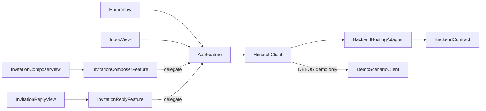
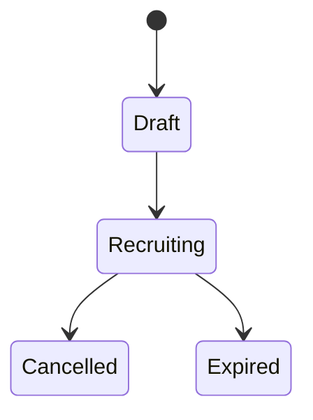

> 適用範囲（2026-10-29）: この文書は既存の手動募集・招待・部分回答の互換性契約を記録する。第一段階の中心は [自動提案・予定成立](../automatic-friend-scheduling/requirements.md) へ置換した。本文の「対象外」は手動Hosting境界の対象外を意味し、製品全体の自動確定・通知を後続へ送る判断には使わない。既存タスクの完了は自動提案の達成証拠ではない。


# Design Document

## Overview

Hosting Domain が手動のお誘いと受信者別の返事を所有し、Root の `AppFeature` が実 Backend との再送・競合・アカウント照合を扱う。Presentation は `InvitationComposerFeature` と `InvitationReplyFeature` に入力と検証を分け、作成はホームの候補・暇・カレンダー範囲・友達から、返事は届いたお誘いから開く。予定確定は AutomaticScheduling が所有し、手動 Hosting の Release 契約には含めない。

## Boundary Commitments

### This Spec Owns

- iOS の募集・回答状態、漏えいしない表示 DTO、受信箱。

### Out of Boundary

- 最終予定確定、Push、レート制限、運営処理、自由投稿。招待の認可は backend-hosting が所有する。

### Allowed Dependencies

- AppFoundation、Availability の区間とカレンダー選択結果、Friendship の friend ID。認可は Backend が所有し、Safety へ静的依存しない。

### Revalidation Triggers

- Hosting API、状態 enum、公開レスポンス、回答者公開範囲、Availability 契約の変更。

## Architecture



BackendContract は backend-hosting の実 API とし、通常Debug/Release Composition は `BackendHostingAdapter` を `HimatchClient` へ接続する。Prototype の手動お誘いは `DemoScenarioClient.business` として明示デモだけに使う。Backend response は invited count、non-responder identity、availability reason を持たない。

## File Structure Plan

```text
apps/ios/Himatch/Hosting/
├── Domain/HostingModels.swift
├── Domain/{TimeCandidatePolicy,ReplyChoicePolicy,ParticipationNoticeDetector}.swift
├── Infrastructure/Adapter/BackendHostingAdapter.swift
└── Presentation/
    ├── Reducer/{InvitationComposerFeature,InvitationReplyFeature}.swift
    └── View/{InvitationComposerView,InvitationReplyView,InvitationSentView}.swift
apps/ios/Himatch/App/Presentation/AppFeature.swift
apps/ios/Himatch/App/Infrastructure/Prototype/DemoScenarioClient.swift  # DEBUG only
apps/ios/HimatchTests/Hosting/
```

## Domain Model

- `Hosting`: id、hostID、mode、category、area、candidateRange、status、version。回答期限は `candidateRange.start` から導出する。
- `HostingArea`: 定義済みエリアまたは `discussLater`。online では nil、offline では必須。
- `ParticipationResponse`: hostingID、responderID、approvedIntervals、status、version。
- すべての時間は半開区間。回答の approvedIntervals は候補期間内かつ本人の選択だけ。



## Application Contracts

`HimatchClient` の Hosting 操作は `loadHostings`、`createHosting`、`respondInvitation(operationID, expectedVersion)`、`cancelHosting(operationID, expectedVersion)` を提供する。`AppFeature` は書き込み開始時の owner を結果 Action に付け、アカウント切替後の結果を破棄する。お誘い作成は選択区間と暇属性を渡し、Backend が暇OR統合と全送信先への送信を一度に確定する。

`HostingDraft.availabilityMetadata` は本人暇のcategoryとvisibilityを明示する。metadataのcategoryがnilなら未選択として送信し、募集カテゴリへフォールバックしない。画面の作成とSiriの作成は明示metadataを渡す。旧呼出しのmetadata未指定と明示未選択を区別する。

Siriの作成・取消はAppRuntimeの本人束縛Clientでセッションの本人を検証し、同じtokenで既存Adapterへ送る。Siri経路はmutation応答で成功判定し、後続の暇GETを省略する。通常Rootのsnapshot取得は維持する。入力補完・確認・結果不明の保護記録はios-siri-actions、表示更新・認証後復帰はApp Integrationの責務とする。operationIDと同じpayloadの再送、expectedVersionの契約は変更しない。

Privacy response rules:

- create response は hosting ID / status / 候補区間 / deadline / version を返し、配信人数を返さない。
- host detail は参加 OK の回答者とその回答区間だけを含み、非公開招待者・未回答・初回見送りを列挙しない。
- invitee detail は本人が回答可能な候補だけを含む。
- 受信者の参加OKは本人の一般的な暇を増やさない。

カレンダー画面のタップ・長押しドラッグ・調整ハンドルから誘う場合は、Availability が正規化した範囲を `InvitationComposerFeature` へ渡す。友達プロフィールからはカレンダーを経由せず、友達を選択済みにして composer を開く。お誘い中表示は Hosting の候補区間を Availability の表示へ重ね、暇枠全体へ状態を広げない。お誘い中区間の削除可否は Backend を正本とする。

## Requirements Traceability

| Requirement | Components | Validation |
|---|---|---|
| 1.1-1.7 | InvitationComposerFeature / InvitationStart | interval / selection / validation tests |
| 2.1-2.5 | privacy response contracts | contract-shape tests |
| 3.1-3.7 | InvitationReplyFeature / ReplyChoicePolicy | reducer / expiry / choice tests |
| 5.1-5.5 | transition policy, detail | state transition tests |
| 6.1-6.4 | Home / Inbox projection, AppFeature | push-independent smoke |
| 7.1-7.4 | HimatchClient commands, AppFeature | idempotency / ambiguity / owner tests |

## Error and Testing Strategy

- business errors: expired、notFriend、blockedCombination、versionConflict、hostingUnavailable。
- permission lost は詳細を破棄して一覧へ戻す。transport ambiguous は operationID を保持する。
- Domain: 半開区間、15分境界、取消・期限切れ遷移。
- Application: privacy DTO、operationID、version競合。
- Presentation: 各開始経路からの作成、全部・前半・後半・時間指定の返事、Home / Inbox 投影。
- Integration: 暇の選択 → 実募集 → 別アカウントで回答 → 取消。

## Security Considerations

UIで隠すだけでは Q-01/Q-02 を満たさない。API 実装時は認可済み projection を返し、iOS は内部モデルや他人の暇枠を受け取らない。通常ログへ候補時間や credential を出さない。

## はじめての予定動線による変更
お誘いの作成入力は `AppFeature` の Root State から `InvitationComposerFeature` へ、返事は `InvitationResponseSelection`（廃止）から `InvitationReplyFeature` と `ReplyChoicePolicy` へ移した。作成・回答・取消の API 呼び出し、operationID、expectedVersion、競合時の再取得はこの設計のまま `AppFeature` が担い、結果には開始時の所有者を付けて別アカウントの結果を捨てる。送信中は作成画面を閉じられない。開催形態の表示名は「会い方」（rawValue は不変）。詳細は [ios-first-match-flow の設計](../ios-first-match-flow/design.md)。
