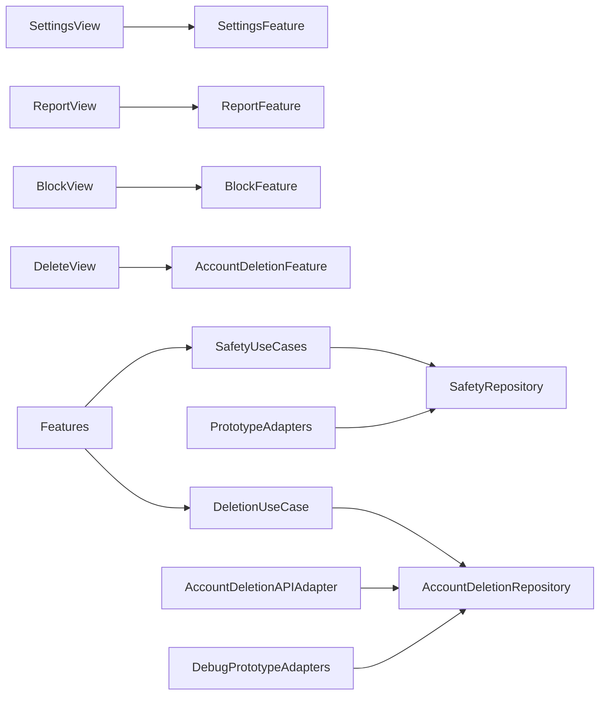

## 第一段階での適用（2026-10-30）

自動提案・予定と友達プロフィールの定型通報/ブロックを実Backendへ接続する。匿名相手は提案IDから解決する。既存Prototypeの任意補足やblock一覧を実保存・実提供されたと表示しない。ブロック/退会でpendingと未来予定を停止する。通知許可・device登録とAPNs配送はAutomaticScheduling/Notificationへ委譲する。

新しい受け入れ条件と実装タスクは [自動提案・予定成立](../automatic-friend-scheduling/requirements.md) と [その実装計画](../automatic-friend-scheduling/tasks.md) を正本とする。既存タスクのチェックは記載された既存契約の証拠であり、新しい提案・確定・通知・安全の達成を示さない。


# Design Document

## Overview

Safety、NotificationSettings、AccountDeletion を Application 境界として分け、Settings はそれらへの Navigation を合成する。通報とブロックは独立コマンド、第一段階の匿名2人のブロックは固定効果の説明 → confirm → server最新状態適用、削除は accepted → processing → completed / actionRequired の長期状態として表す。

## Boundary Commitments

### This Spec Owns

- iOS の通報、ブロック確認、通知設定、設定、文書導線、削除受付・状況表示。

### Out of Boundary

- 運営是正、APNs、Backend内部のApple token revoke・Auth user削除、バックアップ墓石、法的保持。

### Allowed Dependencies

- AppFoundation の suspension、Friendship / Hosting の対象 ID と Navigation contract、UserNotifications の OS 設定導線。

### Revalidation Triggers

- UGCガイド、削除ガイド、匿名ブロック効果、report/受付番号、deletion status、通知許可の変更。

## Architecture



## File Structure Plan

```text
apps/ios/Himatch/Safety/
├── Domain/Model/{Report,BlockImpact}.swift
├── Application/Port/SafetyRepository.swift
├── Application/UseCase/{SubmitReport,ManageBlock}.swift
├── Infrastructure/Adapter/PrototypeSafetyAdapter.swift
└── Presentation/{Reducer,View}/
apps/ios/Himatch/AccountDeletion/
├── Domain/Model/AccountDeletionStatus.swift
├── Application/{Port,UseCase}/
├── Infrastructure/Adapter/{API,Prototype}AccountDeletionAdapter.swift
└── Presentation/{Reducer,View}/
apps/ios/Himatch/Settings/Presentation/{Reducer,View}/
apps/ios/Himatch/Settings/Application/Port/NotificationSettingsRepository.swift
apps/ios/Himatch/Settings/Infrastructure/Adapter/PrototypeNotificationSettingsAdapter.swift
apps/ios/HimatchTests/{Safety,AccountDeletion,Settings}/
```

## State and Contracts

- `ReportTarget`: user(userID, contextID?) / hosting(hostingID, userID?)。
- `ReportReason`: 新しい実契約はspam/harassment/other。成功したoperationIDを受付番号としてDB行と一意に対応付ける。任意補足は旧Prototypeだけに残し、実保存されたと表示しない。
- `BlockImpact`: 旧Prototypeの件数/version previewモデル。新しい匿名2人提案では使用せず、定型の効果説明だけを確認表示し、対象はサーバーで解決する。
- `BlockResult`: 旧Prototypeの影響IDモデル。実契約はAutomaticSchedulingの安全なsnapshotを返し、完了後にFriendship/Hosting投影を再取得する。
- `AccountDeletionStatus`: idle、confirmingImpact、reauthenticating、submitting、accepted(reference, estimate)、processing、completed、actionRequired(reference, message)。fresh Apple再認証からauthorization codeを取得し、UUIDの冪等キーとともにBackendへ送る。
- `NotificationSettingsRepository`: load、save(settings, operationID)、systemAuthorizationStatus。アプリ内購読設定と OS 許可状態を別フィールドにする。
- 自動提案の安全commandはoperationIDを持つ。状態依存の回答/取消だけactor versionを使い、固定効果のブロックへ旧preview versionを要求しない。ambiguous transportは同じoperationID/内容で再送する。

設定の文書 URL は構成値とし、空・無効 URL をリリース検証で失敗させる。本実装では到達先の準備状態を文書化し、架空 URL を有効と見せない。

## Requirements Traceability

| Requirement | Components | Validation |
|---|---|---|
| 1.1-1.5 | ReportFeature | target / retry tests |
| 2.1-2.6 | BlockFeature, BlockImpact, BlockResult | fixed impact / privacy / idempotency / projection reload tests |
| 3.1-3.6 | NotificationSettingsFeature, NotificationSettingsRepository | permission-independent / persistence tests |
| 4.1-4.4 | SettingsFeature, docs | navigation / content review |
| 5.1-5.7 | AccountDeletionFeature | lifecycle / failure tests |
| 6.1-6.4 | value validation, safety adapter | enum / suspension tests |

## Testing Strategy

- Domain/Application: 旧Prototypeの補足上限、実定型reason、固定ブロック効果、deletion lifecycle、ambiguous retry。
- Presentation: 対象自動設定、通報成功・失敗、ブロック影響再確認、設定一覧、削除受付。
- Integration: 招待詳細から通報、プロフィールからブロック、設定から削除、利用停止中の許可画面。
- Backend integration: Apple本人照合、token revoke、Supabase hard delete、actionRequired。
- Manual required: 実Apple/Supabase staging、APNs、運営是正、通知本文。

## Security Considerations

- 通報補足、暇、credential を通常ログへ出さない。
- Push は opaque な更新通知だけを使い、詳細は認証・認可後に取得する。
- アクセス停止と削除完了を別状態にし、外部処理失敗で再ログインを許さない。
